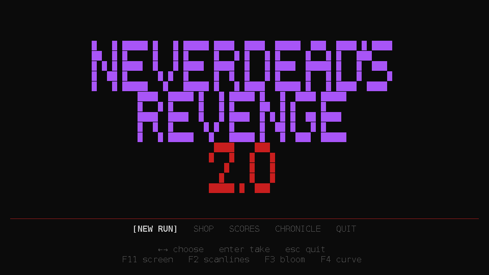
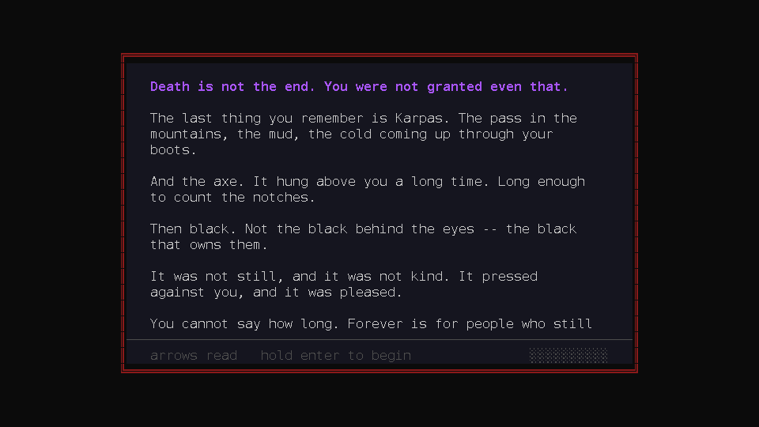
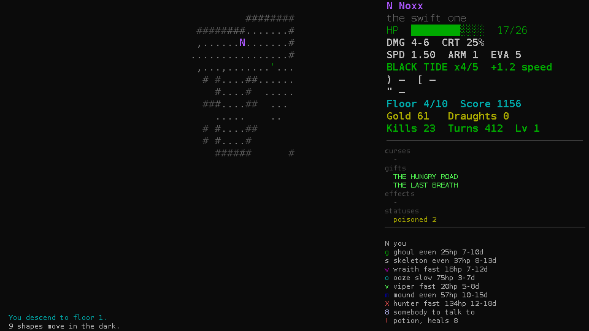
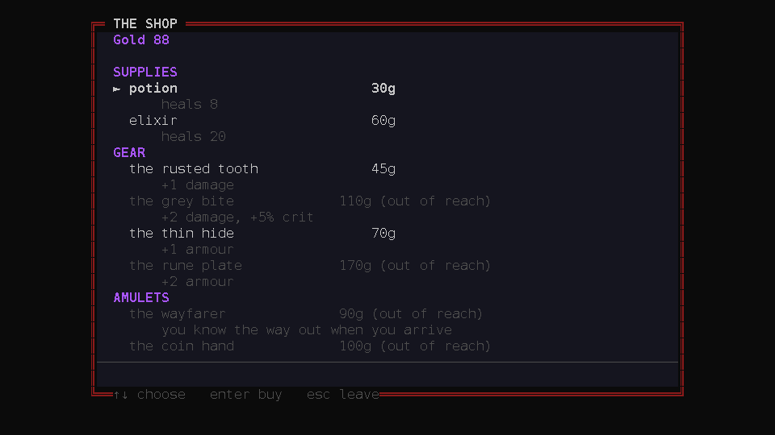

# Neverdead's Revenge 2.0

**The same dungeon, on a CRT.**

Noxx was killed once, and death did not keep him: the body walked out of the
underdark with a price to settle. Under the mountains of Karpas there is a
dungeon for people like that -- ten floors of monsters that get harder the whole
way down, a shop between them that sells next-run time, chests that charge a
curse before they open, and a floor where something already knows where you are
and is on its way. There is one rule above the others: the way out is not behind
you. **The rift is on floor ten.**

This is the desktop build of the **terminal roguelite**. The dungeon, the
monsters, the curses, the gifts, the shop, the save format and the balance are
the *same systems* -- forked wholesale from the terminal project, which was
frozen the day this one started. What is new is everything above them: a
PySide6 window, a pattern buffer, and a fragment shader that puts scanlines,
bloom and a toggleable barrel over the picture. It is a **fork, not a wrapper**,
and from here this is where the game lives.

| | |
| --- | --- |
|  |  |
| the title, and its menu read sideways | the premise: once per session, and the only prose in the game |

## Heroes

Three to pick from, each a philosophy as much as a stat line:

| | name | title | the shape of it |
| --- | --- | --- | --- |
| **N** | Noxx | the swift one | Quick hands, quicker feet. Wins fights he should lose: strike, vanish, come back before they can swing. Fragile, but every opening is lethal. |
| **Y** | Yeti | the unmoved | Slow as a glacier and about as easy to move. Does not dodge and does not rush; everything that reaches him has to get through the armour first, and most things do not. |
| **W** | Walkyrion | the even blade | No weakness worth naming and no trick worth relying on. Strikes on time, takes the hit he has to, and is still standing when the screaming stops. |

Every kill charges **REVENGE**, and the grant is personal: Noxx's stacks flood
his **BLACK TIDE**, Yeti hardens the **FROZEN FORTRESS**, Walkyrion sharpens the
**AURAL BLADE**. It builds as the floor bleeds and it lapses on the way down --
a fight carried through the stairs is a fight that has not happened yet.

## The shape of a run

- **Ten floors**, a freshly generated dungeon each: rooms, grass, rubble, a
  spring that washes a curse off for a price, loot that may be standing under
  something you have to fight for, and the way out where it is not easy to be.
- **The borrowed hour.** Once a floor, the run can be turned one turn back
  from held snapshots -- and the ending offers it one last time: `r` on the
  death tally takes the death back. Unspent, it is gone when the floor is.
- **The hunter.** On the deeper floors, sometimes: fast, scaled up, and already
  moving. It knows where you are because that is all it does, and the game
  tells you when the floor has one.
- **Cursed chests.** A chest names its price -- a curse -- before the lid
  moves: take the reward and carry it, or walk past. A chest whose price you
  already carry opens for nothing. And the wager runs the other trade: leave
  the cursed blade where it lies, take the curse, and bank **fame** into the
  score instead.
- **The shop**, priced and honest. What the purse cannot reach is drawn grey
  with the reason beside the price; the shelves are sectioned (supplies, gear,
  amulets, upgrades); and a shelf of **wild offers** -- the pact, the wager, the
  blind box, the coin hand -- rotates between runs and sells exactly the risks
  their names suggest.

| | |
| --- | --- |
|  |  |
| floor four: the tide charged, a wound taken, the hour kept | the shop, sectioned and priced to what you have |

- **Gifts are rule changes, not loot names.** THE HUNGRY ROAD cuts whatever
  walks in your trail; MOMENTUM lands the next blow harder, the longer you walk
  one way; THE DEBT OF BLOOD owes back everything you are made to bleed; THE
  LAST BREATH turns three desperate health into double force and harder evasion;
  THE SALT CIRCLE makes three waits in a row unreachable; THE BLOOD PRICE
  scatters coins where you are hit; THE KINDNESS makes anyone you meet hand over
  something to drink; NOTHING WASTED shatters a drunk draught into everyone
  beside you; and THE DARK KNOWS shows every monster on the floor, through
  walls.
- **Deaths leave pixels.** A kill bursts red at the exact square it happened on,
  coins rattle out where a monster paid for its cruelty, and a critical lands
  with a spark. The glass shakes on wounds: the picture samples, the world
  does not.

After the tally there is a name for the board, and a slot the title will offer
back. `s` in the pause writes the run in progress even earlier; `c CONTINUE`
takes it whole -- the floor, the health, the turns paid -- and consumes it, so
nothing waits twice. A fresh game reads the premise to you once per session;
by the second run there is no speech before floor one.

## On the glass

The screen runs through a **pattern buffer** -- a grid of characters turned into
one flat image -- and then a shader lays scanlines, bloom and (F4, off at first)
a barrel over it. The scale lands the grid near **a hundred columns**: a whole
pixel per character step on a small laptop, two on 1080p, four on 4K, and the
frame is letterboxed exactly where the number does not divide. Small text is not
a smaller dungeon: the log keeps a face of its own, drawn straight onto the
frame, with the sidebar's curses, gifts, effects and statuses above a rule, and
the legend of glyphs under another.

| key | what it does |
| --- | --- |
| `F11` | fullscreen, and back (the game **starts** fullscreen) |
| `F2` | scanlines on/off |
| `F3` | bloom on/off |
| `F4` | the CRT's curve on/off |

The glass remembers its effects between runs, and every toggle is announced on
the glass itself.

## The keys

The dungeon plays exactly like the terminal game:

| key | does |
| --- | --- |
| `↑↓←→` / `hjkl`, `yubn` | move (the diagonals are real: 8-way) |
| `.` or `space` | wait a turn (and hold the salt circle, with the gift) |
| `enter` | loot, stairs, spring, or speak |
| `q` / `i` | drink / pack |
| `c` / `?` | the sheet / the reference |
| `esc` | the pause (`s` save and quit, `q` to title, `m` sound) |
| `←→` + `enter` | the menus, sideways -- or their letters straight |

Nothing answers a repeated key that never pressed: a held `enter` cannot open a
chest and then agree to it in the same breath, because Qt tells the game when a
key is held and a menu answers one gesture at a time. The holds -- the prologue,
the death tally -- are the one place a held key is the *point*: the fill runs on
the wall clock, a release ends it, and taps never sneak through.

## Getting started

```sh
./install.sh
```

The installer does **whatever is missing**: it creates a `.venv` in this
directory, installs the game and its dependencies into it, checks the imports
(PySide6/miniaudio), and on Linux adds the game to the applications menu --
with a real icon, no sudo, nothing outside `$HOME`. Run it again any time; it
reuses what is already there. `--dry-run`, `--no-desktop`, `--python PATH` and
`--uninstall` are supported.

The long way, if you prefer doing it by hand:

```sh
python3 -m venv .venv
./.venv/bin/pip install -e '.[dev]'
./ndr2
```

The same launcher takes the flags the terminal build had:

```sh
./ndr2 --seed 42     # the same dungeon, again
./ndr2 --no-sound    # start silent
./ndr2 --sound-log   # every sound decision, to /tmp/ndr2-sound.log
./ndr2 --testrun     # the chronicle unlocked and the purse full
```

Runs on **PySide6** and **miniaudio**, and needs a display: the design is the
screen. Headless environments run the test suite instead, offscreen:

```sh
./.venv/bin/pytest -q
```

## Where things live

```text
src/neverdeads_revenge/
  core/ world/ game/ persistence.py   the forked systems -- no screen anywhere
  desktop/                            the PySide6 presentation layer
    buffer.py   the grid of characters -> an image
    crt.py      the shader: integer scaling, scanlines, bloom, geometry
    render.py   the map, the sidebar and the log strip, as cells
    effects.py  the moving pixels: blood, coins, sparks, and the shake
    app.py      the window, the keys, the loop, the settings
    screens/    every menu and dialog, drawn and key-routed
tests/                               1,383 at this writing, engine and UI both
```

The engine (`core/`, `world/`, `game/`) never imports a UI, so the game stays a
library another client could drive -- which is the rule the fork is built on.

## Save data

2.0 keeps its own profile in `~/.local/share/neverdeads_revenge2/`, separate
from the terminal build, on purpose: experimenting here never touches a terminal
run's scores or chronicle, and the other way around.

## Licence

MIT. See `LICENSE`.
